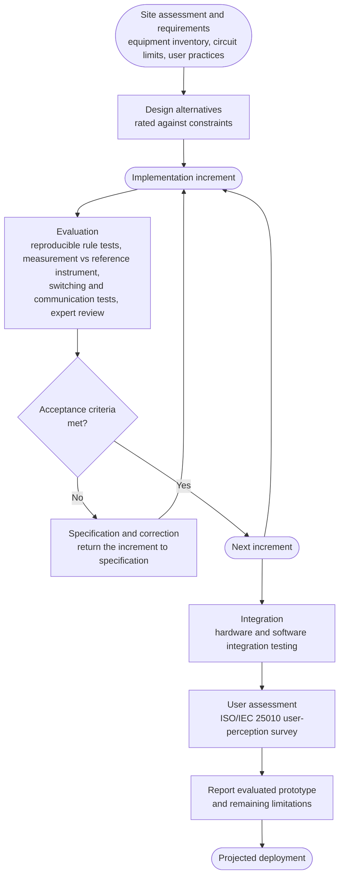
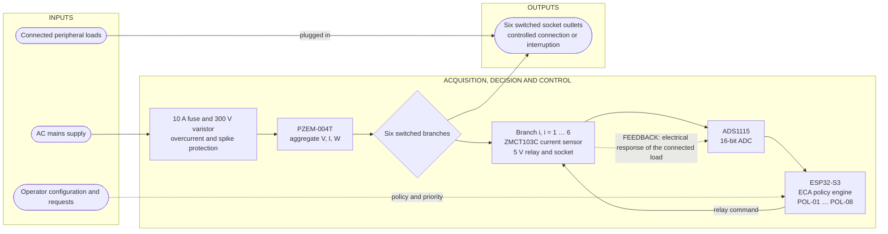
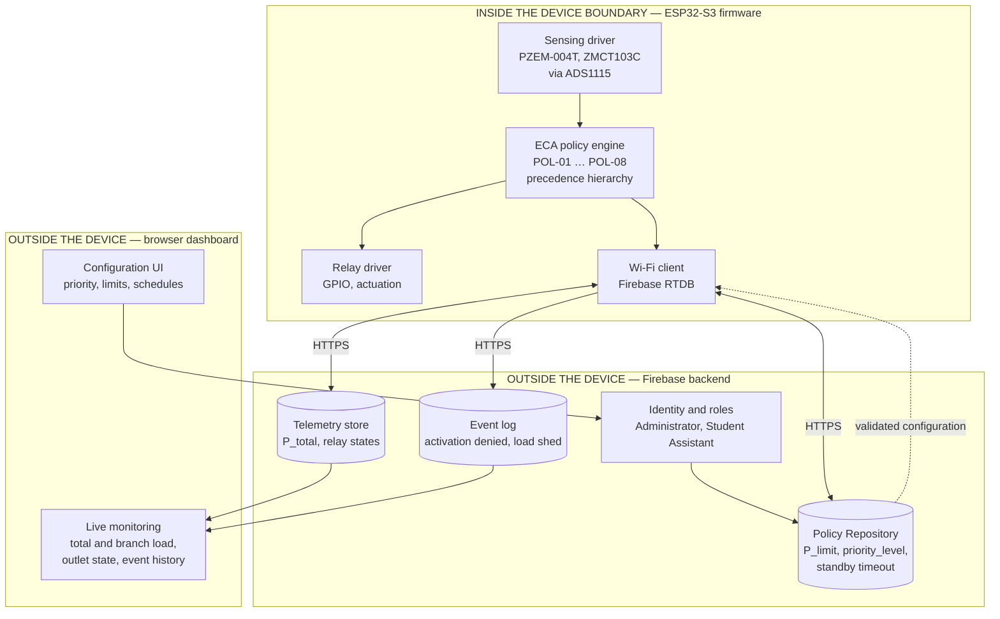
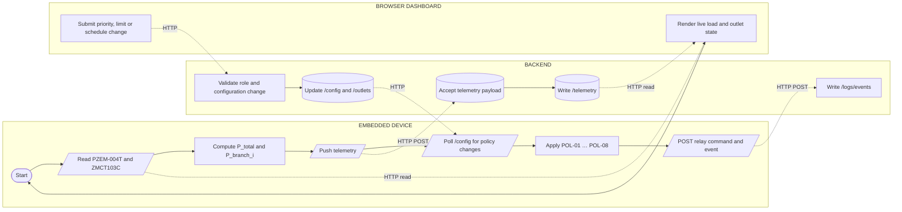
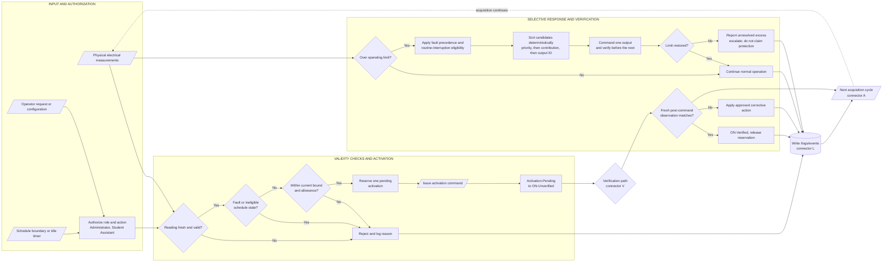

# Chapter 3 — GPT Methodology Figures, ported to the Ch. 3 Revision tab

Source of the **figure concepts**: Google Doc tab **"GPT"** (`t.h4q2fhjexsk1`), Figures 2–6.
Target: the live manuscript in tab **"Ch. 3 Revision"** (`t.13td6aj76ye4`).

**Hardware binding is Ch. 3 Revision's, not GPT's — read this before using the diagrams.**
GPT's text specifies a nine-unit configuration (`AC1–AC7`, `AUX110`, `USB-G`) and an `ADS1015`.
Ch. 3 Revision specifies **six AC branches** and an **ADS1115**. Porting GPT's figures verbatim would put
`ADS1015` and "nine outputs" into a manuscript whose own text says six branches and ADS1115.
These diagrams therefore keep GPT's *structure and intent* and are bound to the build you actually have.
**If you are building the nine-unit configuration, tell me and I will regenerate this set.**

## Numbering — resolve before inserting

Ch. 3 Revision already owns Figures 2–6, and so does GPT. Inserting these without renumbering collides.
Suggested insertion, keeping your existing 3D (7–13) and UI (14–19) figures intact at the end:

| New | GPT name | Current number it displaces |
|---|---|---|
| Figure 7 | Iterative Research and Development Process | old 7–13 → 12–18 |
| Figure 8 | Hardware Input–Process–Output Block Diagram with Feedback | |
| Figure 9 | Software Architecture and Final Hardware Boundary | old 14–19 → 19–24 |
| Figure 10 | Current Sensing and Dashboard Process | |
| Figure 11 | Proposed System Input–Process–Output Flowchart | |

Also regenerate the List of Figures — the current one already omits Figures 12, 13, 15, 16.

---

## Figure 7 — Iterative Research and Development Process

GPT §3.2: requirements and design alternatives inform each implementation increment; unmet acceptance
criteria return the increment to specification and correction; completed increments support subsequent
integration, user assessment, and reporting.

---

## Figure 8 — Hardware Input–Process–Output Block Diagram with Feedback

GPT's key instruction: the feedback path is **the electrical response of the connected loads**, not a
database status arrow. That distinction is the whole reason the figure exists.

> The dashed edge is the feedback the panel will look for. It is deliberately **not** drawn as a status
> arrow from the database — that was GPT's stated correction to the earlier diagram style.

---

## Figure 9 — Software Architecture and Final Hardware Boundary

GPT's purpose: stop the conceptual framework diagram being read as an implementation diagram, and show
which parts of the architecture are *outside* the physical device.

> Dashed edges are remote configuration paths; solid edges are local processing. Only the **DEVICE**
> subgraph is the hardware boundary — the adviser asked for that distinction to be drawn explicitly.

---

## Figure 10 — Current Sensing and Dashboard Process

Three lanes: embedded device, backend, browser. Dashed arrows are HTTP transfers between independently
executing components. This figure states **present** behaviour; Figure 11 states **required** behaviour.

> **Known limit to state in the caption, not hide:** a displayed disconnection is a database outcome,
> not proof of a physical action, and later telemetry can reconcile a non-restricted record back to
> Active/Standby. GPT flagged this explicitly. Figure 11 is the required behaviour that closes the gap.

---

## Figure 11 — Proposed System Input–Process–Output Flowchart

Inputs and authorization on the left, validity checks and activation in the centre, selective response
and physical verification on the right. This figure specifies **required** behaviour.

> Connectors **A**, **V**, **L** are Mermaid-only labels standing in for the off-page connectors GPT
> specifies in Appendix I. Keep them identical across Figures 10 and 11 so the two connect.

---

## Caption guidance

Adviser item 3.3 requires a textual discussion for every figure. Write one short paragraph per figure
stating: what the figure shows, what feedback path it depicts, and what it does **not** claim about the
current build. GPT's Figures 5 and 6 are the model — 5 says what the system does now, 6 says what it must
do, and neither is allowed to imply unimplemented behaviour is working.
