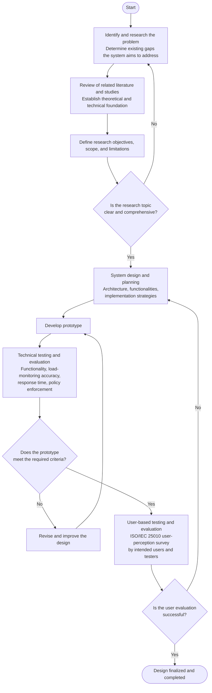
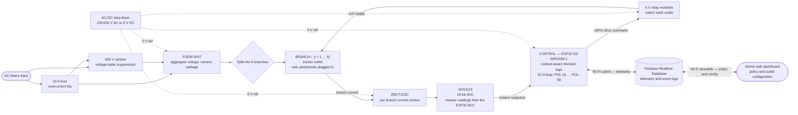
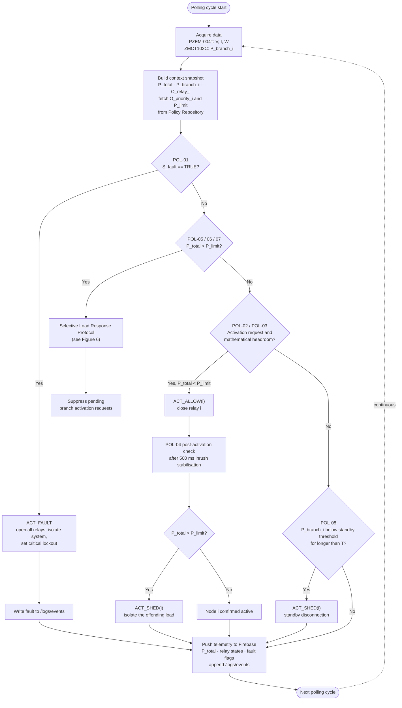
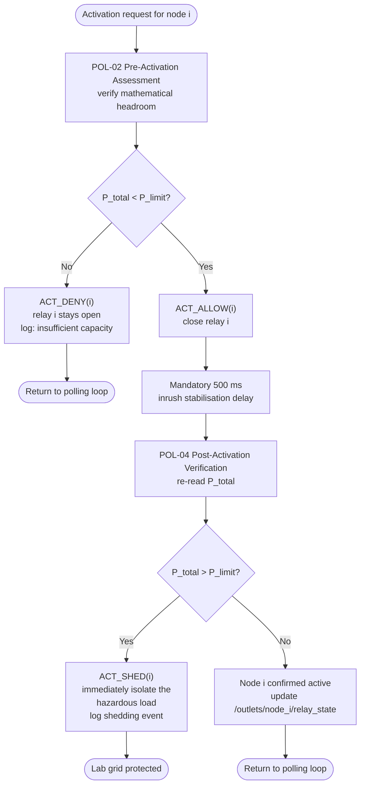
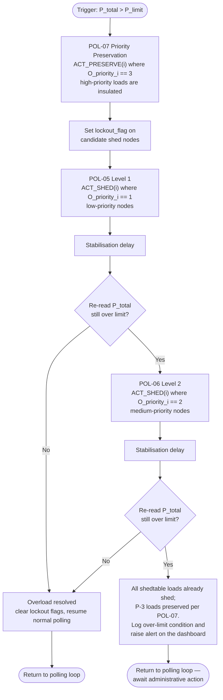

# Chapter 3 — Methodology Figures (Mermaid source)

Basis: Google Doc tab **"Ch. 3 Revision"** (`t.13td6aj76ye4`).
Each block is standalone — paste straight into <https://mermaid.live> → *Copy SVG* → drop into Miro, or use
Miro's **Apps → Mermaid** / *Insert → Code block* if your board supports it.

Figures are numbered to match the existing List of Figures (Figure 2 → Figure 6). Captions and the
"Diagram Description" paragraphs already exist in the manuscript — this file only supplies the diagrams.

---

## Figure 2: Process Flowchart of the Research

Manuscript source: §3.2 Flowchart of Research Design / Process Flowchart.

> Loop-backs `E → B` and `L → F` mirror the manuscript text at §3.2; `I → J → G` is the revise-and-retest
> cycle. Keep both — a single-pass flow is what the panel reads as "no iteration was actually performed."

---

## Figure 3: Block Diagram of the System

Manuscript source: §3.5 Design Project Flow, "Diagram Description". Closes the loop the adviser asked for:
sensing → decision → switching → back to sensing.

> **The closed loop is `BR → CT → ADC → MCU → RELAY → BR`** — sense, decide, switch, load returns. Keep all
> five arrows visible. That loop is what the adviser asked for in the "Closed-Loop Hardware Block Diagram"
> item; a diagram that stops at the ESP32 reads as a wiring sketch, not a control system.
>
> No `subgraph` blocks are used on purpose. Mermaid relocates a node that is referenced by an edge *before* its
> own subgraph is declared, which produced an empty "Control" box and a tangled left-to-right flow on the first
> draft. If you want grouping in Miro, group the boxes by hand after import.

> The dashed `B1 → CT` edge is the feedback path. If your board resists drawing it, keep the edge — it is the
> single thing that makes this a *closed-loop* diagram rather than a wiring sketch.

---

## Figure 4: ECA Polling Loop

Manuscript source: Table 6 (Policy Execution Matrix) and "Conflict Resolution and Execution Precedence".
Order is the **precedence hierarchy**, not the table order: POL-01 → POL-05/06/07 → POL-02/03 → POL-08.

---

## Figure 5: Branch Activation & Verification Sub-Routine

Manuscript source: §3.5 "Branch Activation & Verification Sub-Routine", POL-02 → POL-03 → POL-04.
The 500 ms stabilisation delay is mandatory — do not shorten it in the diagram, it is the inrush window.

---

## Figure 6: Selective Load Response Protocol

Manuscript source: §3.5 "Selective Load Response Protocol" narrative — shedding is **sequential**, to prevent
cascading failure and relay oscillation; priority-3 nodes are insulated by POL-07.

---

## Notes for whoever pastes these in

1. **Figure 4 vs Figure 6 overlap.** Figure 4 deliberately contains one collapsed node
   ("Selective Load Response Protocol — see Figure 6"). Keep the reference; it saves a cluttered page and the
   two figures then read as overview + detail.
2. **Precedence order is load-bearing.** In Figure 4 the order is POL-01 → threshold response →
   pre-activation → standby. This is *not* the numeric order of Table 6 and a reader who assumes it is will
   misread the firmware. If the panel asks, this is the answer from §"Conflict Resolution and Execution
   Precedence".
3. **`P_limit` is named two ways in the manuscript** — 2500 W in §"Power Rating and Operating Limit" and
   `system_limit_amps` in Table 3. The diagrams use `P_limit` throughout; keep the manuscript's own
   definition sentence when the figure is discussed.
4. **List of Figures is out of date.** The front-matter LoF lists Figures 7–11 and 14, 17, 18, 19 but omits
   **12, 13, 15, 16**, which do exist in the body. Regenerate the LoF when the figures are final.
5. **Figure 1** (Conceptual Diagram of the Proposal) belongs to Chapter 1, not the methodology set, so it is
   not included here.
